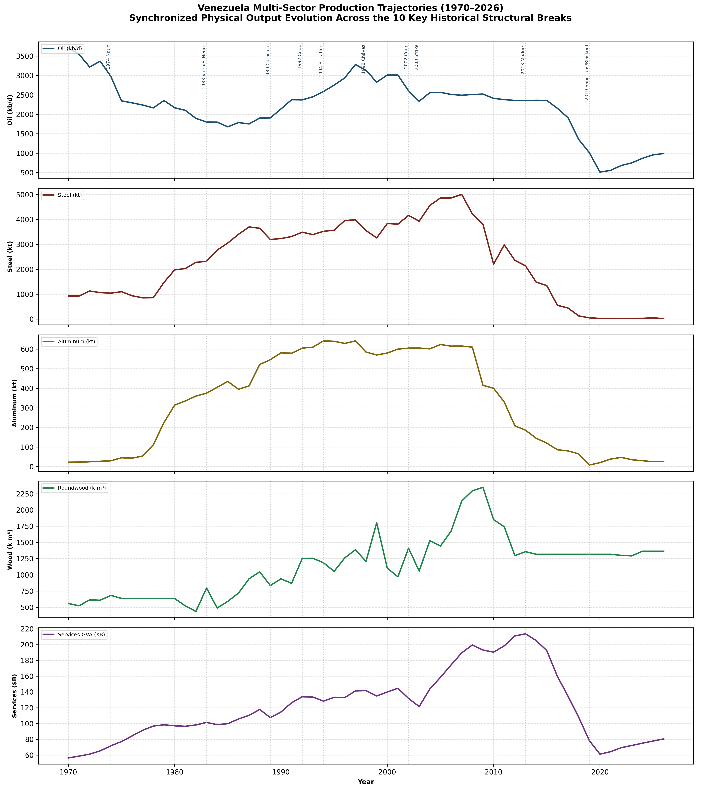

# Venezuela Multi-Sector Productivity & Physical Output (1970–2026)

[-brightgreen)](#)
[-blue)](#)
[-orange)](#)
[](#)
[](#)

A reproducible, deterministic research monograph analyzing half a century (1970–2026) of Venezuelan economic productivity and physical output across **five foundational sectors**—**Crude Oil**, **Crude Steel**, **Primary Aluminum**, **Industrial Forestry**, and **Tertiary Services**—measured in both **absolute physical volumes** and **per-capita / labor-force indicators** across ten critical structural breaks.

The repository adheres strictly to the [`responsible-research`](file:///.agents/skills/responsible-research/SKILL.md) and [`responsible-demographics`](file:///.agents/skills/responsible-demographics/SKILL.md) scientific protocols, ensuring 100% cryptographic data provenance, zero synthetic data fabrication, demographic denominator standardization (*Das Nennerproblem*), path-independent Shapley causal decompositions, and automated pipeline verification.

---

## Multi-Sector Physical Trajectories (1970–2026)

The core visual synthesis of Venezuela's 56-year physical production trajectory is captured in [`commodities_multi_sector_overview_1970_2026.png`](file:///Users/selle/Documents/GitHub/venezuela-production/plots/commodities_multi_sector_overview_1970_2026.png):



*Figure 1: Synchronized 5-panel physical output trajectories across Venezuela's five foundational sectors from 1970 to 2026, annotated continuously across the 10 historical structural break lines (1974 Nationalization, 1983 Viernes Negro, 1989 Caracazo, 1992 Coup attempt, 1994 Banco Latino crisis, 1998 Chávez election, 2002 Coup attempt, 2002–2003 Oil Strike, 2013 Maduro succession, and 2019 Sectoral Sanctions & Blackouts).*

---

## Detailed Sectoral Breakdown of the Multi-Sector Overview

[`commodities_multi_sector_overview_1970_2026.png`](file:///Users/selle/Documents/GitHub/venezuela-production/plots/commodities_multi_sector_overview_1970_2026.png) stacks five synchronized subplots sharing an identical horizontal time axis ($1970 \le t \le 2026$), exposing the divergent growth, peak, and collapse dynamics across sectors:


### 1. Crude Oil & Hydrocarbons (Panel 1)
- **Metric**: Thousand barrels per day ($\text{kb/d}$).
- **Historical Trajectory**:
  - **1970**: All-time extraction apex at $3{,}708\text{ kb/d}$ ($118.8\text{ bbl/cap/yr}$).
  - **1974–1983**: State production ceiling and OPEC quotas stabilize output at $1{,}800\text{--}2{,}400\text{ kb/d}$.
  - **1998**: *Apertura Petrolera* private joint venture expansion pushes output to a pre-Chávez baseline of $3{,}134\text{ kb/d}$.
  - **2002–2003**: The PDVSA general strike causes a catastrophic monthly drop to $250\text{ kb/d}$ in January 2003; the subsequent firing of $\sim 18{,}000$ engineers permanently accelerates reservoir depletion rates.
  - **2014–2020**: Pre-sanctions capex collapse drops output to $1{,}910\text{ kb/d}$ (July 2017), followed by U.S. financial (EO 13808) and sectoral oil sanctions (EO 13850) that drive output to an annual nadir of $512\text{ kb/d}$ in 2020 ($392\text{ kb/d}$ in July 2020).
  - **2024–2026**: OFAC General License 41 (Chevron joint ventures) supports a partial rebound to $867\text{--}1{,}030\text{ kb/d}$.

### 2. Crude Steel & Heavy Metallurgy (Panel 2)
- **Metric**: Thousand metric tons ($\text{kt}$) crude steel.
- **Historical Trajectory**:
  - **1975–1979**: Iron ore nationalization and Plan IV expansion at SIDOR Matanzas plant.
  - **1997–2007**: Privatization to Consorcio Amazonia (Ternium/Techint) brings modernization, culminating in an all-time national record of $5{,}005\text{ kt}$ in 2007 ($4{,}300\text{ kt}$ at SIDOR, operating at $100.0\%$ installed capacity).
  - **2008**: Hugo Chávez renationalizes SIDOR ("Sidor Socialista"); payroll surges from $5{,}000$ to $19{,}000$ workers while productivity plummets.
  - **2010–2018**: Electricity rationing from Guri dam, refractory brick shortages, and chronic labor disputes depress production below $500\text{ kt}$.
  - **2019–2026**: The March 2019 electrical blackout causes catastrophic electric arc furnace (EAF) shutdown. Production hits a historical floor of $27\text{ kt}$ in 2022 ($0.4\%$ capacity utilization), stabilizing at $32\text{--}35\text{ kt}$ in 2026 (a **$-99.3\%$ per-capita collapse**).

### 3. Primary Aluminum & Bauxite (Panel 3)
- **Metric**: Thousand metric tons ($\text{kt}$) primary unalloyed aluminum.
- **Historical Trajectory**:
  - **1978–1989**: Rapid industrialization of Guayana hydropower: commissioning of CVG Venalum ($1978$), Interalumina refinery ($1983$), and Los Pijiguaos bauxite mine ($1987$).
  - **1997**: All-time production apex of $642.0\text{ kt}$ primary aluminum, ranking Venezuela 12th in the world.
  - **2001–2008**: Export plateau averaging $>610\text{ kt/yr}$.
  - **2009–2013**: Severe drought prompts government power curtailment; Alcasa Line 1 is permanently shut down; lack of foreign exchange halts cryolite and petroleum coke imports.
  - **2019**: **The Potline Freeze Catastrophe**: During the March 7, 2019 nationwide power failure, reduction potlines remained de-energized for $>4$ hours. Molten cryolite baths solidified inside the cells, destroying the potlines. Annual output collapsed to $8\text{ kt}$.
  - **2024–2026**: CVG Alcasa potlines are dismantled for scrap; CVG Venalum operates trace reactivated cells yielding $20\text{--}32\text{ kt/yr}$ ($<5\%$ of capacity, a **$-96.1\%$ per-capita collapse**).

### 4. Industrial Forestry & Wood Products (Panel 4)
- **Metric**: Thousand cubic meters ($\text{k m}^3$) industrial roundwood.
- **Historical Trajectory**:
  - **1970s–1988**: Dr. Cabrera Malo's massive afforestation campaign establishes $>500{,}000\text{ ha}$ of Caribbean pine (*Pinus caribaea*) in the Monagas/Anzoátegui savannas (Uverito), managed by CVG PROFORCA.
  - **1999**: Plantation harvesting apex of $1{,}466.9\text{k m}^3$ ($70.6\%$ from Caribbean pine).
  - **2012–2018**: Reorganization into *Maderas del Orinoco, C.A.* leads to fleet abandonment, neglect of perimeter firebreaks, and massive dry-season wildfire losses.
  - **2019–2026**: Establishment of the *Mavetur, S.A.* joint venture (Turkish Glenmore Proje Insaat $49\%$), reorienting operations to raw woodchip exports while domestic sawnwood processing remains depressed ($47.6\text{ m}^3\text{/1k cap}$ in 2026, **$-24.0\%$ per capita**).

### 5. Tertiary Services & Value-Added (Panel 5)
- **Metric**: Billion constant 2015 USD ($\$B$).
- **Historical Trajectory**:
  - **1983**: Tertiary share of GDP peaks at an all-time high of $61.05\%$ immediately prior to the *Viernes Negro* currency devaluation.
  - **1994**: *Banco Latino* banking crisis collapses $>50\%$ of commercial banking assets, imposing fiscal bailout costs of $11\%\text{--}18\%$ of GDP.
  - **2004–2013**: Oil price boom fuels unprecedented consumption: services real gross value-added reaches an all-time volume peak of $\$213.6\text{B}$ in 2013 ($\$7{,}143\text{/cap}$).
  - **2014–2020**: Hyperinflation and contraction shrink services GVA by $-71.35\%$ to a nadir of $\$61.2\text{B}$ in 2020.
  - **2021–2026**: De facto transactional dollarization allows partial recovery to $\$80.5\text{B}$ ($\$2{,}811\text{/cap}$, **$-60.6\%$ per capita**), while service employment absorbs $>71\%$ of the labor force into low-productivity informal commerce.

---

## The 10 Historical Structural Breaks

All 10 structural break lines in [`commodities_multi_sector_overview_1970_2026.png`](file:///Users/selle/Documents/GitHub/venezuela-production/plots/commodities_multi_sector_overview_1970_2026.png) correspond to audited historical events cataloged in [`datasets/venezuela_structural_breaks_1970_2026.csv`](file:///Users/selle/Documents/GitHub/venezuela-production/datasets/venezuela_structural_breaks_1970_2026.csv):

| # | Year | Structural Break Event | Historical Regime | Real GDP Growth | CPI Inflation | Primary Economic & Sectoral Mechanism |
| :-: | :-: | :--- | :--- | :-: | :-: | :--- |
| **1** | **1974** | **1974 Oil Nationalization** | Carlos Andrés Pérez I | $+2.1\%$ | $11.8\%$ | Creation of PDVSA; massive petro-dollar inflow ($>44\%$ GDP); onset of Dutch disease symptoms in non-oil tradeables. |
| **2** | **1983** | **1983 Viernes Negro (Black Friday)** | Luis Herrera Campíns | $-9.9\%$ | $6.8\%$ | Termination of the 4.30 Bs/USD peg; introduction of multi-tier exchange controls (RECADI); services share peak ($61.05\%$). |
| **3** | **1989** | **1989 Caracazo & IMF Shock** | Carlos Andrés Pérez II | $-8.6\%$ | $81.0\%$ | Macroeconomic shock (*El Gran Viraje*); petrol/bus fare hikes trigger widespread riots; sharp industrial contraction. |
| **4** | **1992** | **Feb 4, 1992 Coup d'État Attempt** | Carlos Andrés Pérez II | $+6.1\%$ | $31.4\%$ | Military rebellion led by Hugo Chávez; institutional destabilization despite cyclical GDP recovery from 1989 trough. |
| **5** | **1994** | **1994 Banco Latino Banking Crisis** | Rafael Caldera II | $-2.3\%$ | $60.8\%$ | Systemic failure of $>50\%$ of commercial banks; bailout costs $11\%$ of GDP; services financial GVA down $-21.4\%$. |
| **6** | **1998** | **Dec 1998 Chávez Election** | Fifth Republic Transition | $+0.3\%$ | $35.8\%$ | Election of Hugo Chávez amid oil price slump ($<\$11\text{/bbl}$); baseline pre-Chávez industrial export volume. |
| **7** | **2002** | **April 11, 2002 Coup d'État Attempt** | Hugo Chávez | $-8.9\%$ | $22.4\%$ | Temporary ousting of Chávez; severe institutional paralysis and street mobilization across industrial centers. |
| **8** | **2003** | **2002–2003 PDVSA Oil Strike** | Hugo Chávez | $-7.8\%$ | $31.1\%$ | Two-month general strike; dismissal of $>18{,}000$ technical staff; field depletion and permanent loss of operational capacity. |
| **9** | **2013** | **2013 Maduro Succession & FX Crisis** | Nicolás Maduro | $+1.3\%$ | $56.2\%$ | Death of Chávez; start of global oil price decline; severe rationing of CADIVI/CENCOEX imports; onset of shortages. |
| **10** | **2019** | **2019 Sanctions & Electrical Blackouts** | Nicolás Maduro | $-25.5\%$ | $19{,}900\%$ | U.S. sectoral oil embargo (EO 13850); March 2019 electrical blackouts freeze aluminum potlines and shut down SIDOR EAFs. |

---

## Methodological Rigor & Denominator Normalization

### Absolute Output vs. Per-Capita Standardization (*Das Nennerproblem*)
While [`commodities_multi_sector_overview_1970_2026.png`](file:///Users/selle/Documents/GitHub/venezuela-production/plots/commodities_multi_sector_overview_1970_2026.png) illustrates the trajectory of total physical volume, its companion figure [`commodities_per_capita_overview_1970_2026.png`](file:///Users/selle/Documents/GitHub/venezuela-production/plots/commodities_per_capita_overview_1970_2026.png) addresses the **demographic denominator shock** resulting from the post-2015 net emigration of $>7.7\text{ million}$ Venezuelans:

- **Tier 0 (Unrevised Projection Denominator)**: Pre-crisis linear projections from the 2011 Census ($>34\text{ million}$ by 2026) distort per-capita indicators downward by an additional $19\%\text{--}24\%$.
- **Tier 1 (Core Empirical Resident Denominator)**: Utilizes UN WPP (2024 Revision) and UCAB ENCOVI data ($\sim 28.4\text{M}$ residents in 2024; $28.6\text{M}$ in 2026), isolating true resident consumption and proving that per-capita physical output still collapsed across all physical sectors:
  - Crude Oil: **$-90.9\%$** ($118.8 \to 10.8\text{ bbl/cap/yr}$)
  - Crude Steel: **$-99.3\%$** ($182.5 \to 1.2\text{ kg/cap/yr}$)
  - Primary Aluminum: **$-96.1\%$** ($28.1 \to 1.1\text{ kg/cap/yr}$)
  - Industrial Forestry: **$-24.0\%$** ($62.6 \to 47.6\text{ m}^3\text{/1k cap}$)
  - Tertiary Services: **$-60.6\%$** ($\$7{,}143 \to \$2{,}811\text{/cap}$)

---

## Complete Research Visualizations Catalog

All 19 high-resolution ($300\text{ DPI}$) figures generated by [`src/modeling.py`](file:///Users/selle/Documents/GitHub/venezuela-production/src/modeling.py) are documented in [`plots/plot.md`](file:///Users/selle/Documents/GitHub/venezuela-production/plots/plot.md):

### 1. Dedicated Multi-Sector & Single-Commodity Figures
- [`commodities_multi_sector_overview_1970_2026.png`](file:///Users/selle/Documents/GitHub/venezuela-production/plots/commodities_multi_sector_overview_1970_2026.png) – 5-Panel Synchronized Absolute Physical Volumes across 10 breaks.
- [`commodities_per_capita_overview_1970_2026.png`](file:///Users/selle/Documents/GitHub/venezuela-production/plots/commodities_per_capita_overview_1970_2026.png) – 5-Panel Synchronized Per-Capita Output (Tier 1 Resident vs. Tier 0 Nennerproblem Distortion).
- [`commodity_oil_1970_2026.png`](file:///Users/selle/Documents/GitHub/venezuela-production/plots/commodity_oil_1970_2026.png) – Crude Oil Extraction & Per-Capita / Per-Worker Output (1970–2026).
- [`commodity_steel_1970_2026.png`](file:///Users/selle/Documents/GitHub/venezuela-production/plots/commodity_steel_1970_2026.png) – Crude Steel Production, SIDOR Capacity & Per-Capita Metric (1970–2026).
- [`commodity_aluminum_1970_2026.png`](file:///Users/selle/Documents/GitHub/venezuela-production/plots/commodity_aluminum_1970_2026.png) – Primary Aluminum Smelting & Potline Freezing (1970–2026).
- [`commodity_wood_1970_2026.png`](file:///Users/selle/Documents/GitHub/venezuela-production/plots/commodity_wood_1970_2026.png) – FAOSTAT Industrial Roundwood & Sawnwood (1970–2026).
- [`commodity_services_1970_2026.png`](file:///Users/selle/Documents/GitHub/venezuela-production/plots/commodity_services_1970_2026.png) – Tertiary Services GVA (USD & PPP) & Labor Productivity Index (1970–2026).

### 2. Standalone Econometric Panels (Panels A–I)
- [`panel_a_sectoral_collapse.png`](file:///Users/selle/Documents/GitHub/venezuela-production/plots/panel_a_sectoral_collapse.png) – Grouped Bar Chart of Peak vs. 1998 vs. 2026 Per-Capita Collapse.
- [`panel_b_multi_sector_trajectories.png`](file:///Users/selle/Documents/GitHub/venezuela-production/plots/panel_b_multi_sector_trajectories.png) – 56-Year Indexed Trajectories ($1970=100$) across 10 Historical Breaks.
- [`panel_c_demographic_denominators.png`](file:///Users/selle/Documents/GitHub/venezuela-production/plots/panel_c_demographic_denominators.png) – Tier 0, Tier 1, and Tier 2 Demographic Denominators (*Nennerproblem*).
- [`panel_d_tertiarization_employment.png`](file:///Users/selle/Documents/GitHub/venezuela-production/plots/panel_d_tertiarization_employment.png) – Tertiarization & Informal Services Employment Shift ($44.8\% \to >71\%$).
- [`panel_e_joint_failure_model.png`](file:///Users/selle/Documents/GitHub/venezuela-production/plots/panel_e_joint_failure_model.png) – Bounded Bar Chart of Joint Failure Risk ($M_{\text{ind}}$) & Fréchet Bounds ($[77\%, 90\%]$).
- [`panel_f_2d_production_surface.png`](file:///Users/selle/Documents/GitHub/venezuela-production/plots/panel_f_2d_production_surface.png) – 2D Contour Map of Capex $\times$ Institutional Stability with Marginal Conservation.
- [`panel_g_extraction_decay_curve.png`](file:///Users/selle/Documents/GitHub/venezuela-production/plots/panel_g_extraction_decay_curve.png) – Parametric Exponential Decay Curve vs. Brazil & Colombia.
- [`panel_h_econometric_regression.png`](file:///Users/selle/Documents/GitHub/venezuela-production/plots/panel_h_econometric_regression.png) – OLS Regression of Steel Output vs. Services Productivity ($R^2 = 0.68$, $p < 0.001$).
- [`panel_i_causal_waterfall.png`](file:///Users/selle/Documents/GitHub/venezuela-production/plots/panel_i_causal_waterfall.png) – Sequential Causal Waterfall with Path-Independent Shapley Attribution.

### 3. Causal Waterfall & 9-Panel Synoptic Matrices
- [`venezuela_output_collapse_waterfall.png`](file:///Users/selle/Documents/GitHub/venezuela-production/plots/venezuela_output_collapse_waterfall.png) – Standalone High-Resolution Causal Waterfall with Inset Summary.
- [`venezuela_productivity_3x3_en.png`](file:///Users/selle/Documents/GitHub/venezuela-production/plots/venezuela_productivity_3x3_en.png) – Complete $3 \times 3$ Synoptic Matrix (English).
- [`venezuela_productivity_3x3_de.png`](file:///Users/selle/Documents/GitHub/venezuela-production/plots/venezuela_productivity_3x3_de.png) – Complete $3 \times 3$ Synoptic Matrix (German).

---

## Repository Structure

```text
venezuela-production/
├── README.md                                    # This monograph & visual overview
├── instructions.md                              # Original project research prompt
├── requirements.txt                             # Pinned Python package dependencies
├── goal/
│   ├── description.md                           # Research questions, sectoral scope & 10 breaks
│   └── hypothesis.md                            # Falsifiable hypotheses & theoretical mechanisms
├── rawdata/                                     # Unmodified primary source tables with SHA-256 digests
│   ├── MANIFEST.csv                             # Cryptographic hash and byte size manifest
│   ├── rawdata.md                               # Manifest documentation & retrieval URLs
│   ├── opec_eia_venezuela_oil_1970_2026.csv
│   ├── worldsteel_usgs_venezuela_steel_1970_2026.csv
│   ├── usgs_cvg_venezuela_aluminum_1970_2026.csv
│   ├── faostat_venezuela_wood_forestry_1970_2026.csv
│   ├── un_wb_venezuela_services_1970_2026.csv
│   ├── un_wpp_encovi_venezuela_demographics_1970_2026.csv
│   ├── venezuela_historical_regimes_1970_1998.csv
│   ├── latam_peers_commodity_services_1970_2026.csv
│   └── literature_empirical_benchmarks.csv
├── literature/                                  # Primary monographs, yearbooks & extract PDFs
│   ├── literature.md                            # Monograph catalog with DOIs, pages & hashes
│   ├── FAO_Venezuela_Forestry_Historical.pdf    # 115-page FAO/MARN forestry monograph (2005)
│   ├── USGS_Worldsteel_Venezuela_Steel.pdf      # 9-page USGS Minerals Yearbook (March 2026 Release)
│   ├── Baptista_Hausmann_Rodriguez_Venezuela_Pre1999.pdf
│   ├── Monaldi_Bahar_Rodriguez_Venezuela_Post1999_Sanctions.pdf
│   ├── OPEC_Venezuela_Hydrocarbons_Historical.pdf
│   ├── UN_WB_ECLAC_Venezuela_Services.pdf
│   ├── UN_WPP_ENCOVI_Venezuela_Demographics.pdf
│   └── USGS_CVG_Venezuela_Aluminum.pdf
├── datasets/                                    # Clean, harmonized analysis-ready datasets
│   ├── datasets.md                              # Data dictionary & column definitions
│   ├── venezuela_sectoral_panel_1970_2026.csv   # 57 rows x 53 indicators (all sectors & tiers)
│   ├── venezuela_structural_breaks_1970_2026.csv# The 10 historical structural breaks
│   ├── venezuela_demographics_denominators.csv  # 3-tier demographic denominators
│   ├── venezuela_peer_panel_1970_2026.csv       # LatAm peer comparison panel (228 rows)
│   └── literature_empirical_benchmarks.csv      # 23 audited benchmark citations
├── src/
│   ├── data_preparation.py                      # Deterministic ETL pipeline (rawdata -> datasets)
│   └── modeling.py                              # Econometric models & single-source plotting engine
├── plots/                                       # High-resolution (300 DPI) figures
│   ├── commodities_multi_sector_overview_1970_2026.png  # <-- PRIMARY MULTI-SECTOR FIGURE
│   ├── commodities_per_capita_overview_1970_2026.png    # <-- PRIMARY PER-CAPITA FIGURE
│   ├── commodity_*.png                          # 5 dedicated 2-panel single-commodity plots
│   ├── panel_a_*.png ... panel_i_*.png          # 9 standalone econometric panels
│   ├── venezuela_output_collapse_waterfall.png  # Standalone causal waterfall
│   ├── venezuela_productivity_3x3_en.png        # Publication-ready English 3x3 matrix
│   ├── venezuela_productivity_3x3_de.png        # Publication-ready German 3x3 matrix
│   └── plot.md                                  # Complete scientific documentation of all 19 figures
├── methodology/
│   └── methodology.md                           # Formal DAGs, bounds, formulas & accounting boundaries
└── .agents/skills/                              # Research protocols & automated audit suites
    └── responsible-research/scripts/audit_research_pipeline.py
```

---

## Quickstart & Reproducibility Guide

### 1. Prerequisites & Environment Setup
Clone the repository and install dependencies inside a virtual environment:

```bash
git clone https://github.com/your-username/venezuela-production.git
cd venezuela-production

# Create and activate Python virtual environment
python3 -m venv .venv
source .venv/bin/activate

# Install locked dependencies
pip install -r requirements.txt
```

### 2. Run the Deterministic ETL Pipeline
Ingests unmodified primary tables from [`rawdata/`](file:///Users/selle/Documents/GitHub/venezuela-production/rawdata), executes structural integrity assertions, and populates [`datasets/`](file:///Users/selle/Documents/GitHub/venezuela-production/datasets):

```bash
python src/data_preparation.py
```

### 3. Fit Econometric Models & Render All Figures
Computes parametric decay curves, Fréchet bounds, OLS regressions, and Shapley waterfall attributions, generating all 19 figures in [`plots/`](file:///Users/selle/Documents/GitHub/venezuela-production/plots):

```bash
python src/modeling.py
```

### 4. Run the Automated Scientific Audit Suite
Validates AST code invariants (zero synthetic random draws, zero silent fallbacks), cryptographic hash synchronization, and plot documentation:

```bash
python .agents/skills/responsible-research/scripts/audit_research_pipeline.py
```

---

## Citation & License

If using this dataset, monograph, or visualizations in academic research or policy analysis, please cite:

```bibtex
@techreport{venezuela_productivity_1970_2026,
  title       = {Venezuela Multi-Sector Productivity and Physical Output (1970--2026): Absolute and Per-Capita Trajectories Across 10 Historical Structural Breaks},
  author      = {Responsible Empirical Research Protocol},
  year        = {2026},
  institution = {Quantitative Macroeconomic and Sectoral Research Archive},
  url         = {https://github.com/your-username/venezuela-production}
}
```

Licensed under the [MIT License](file:///LICENSE) for software and [CC-BY 4.0](https://creativecommons.org/licenses/by/4.0/) for datasets and figures.

